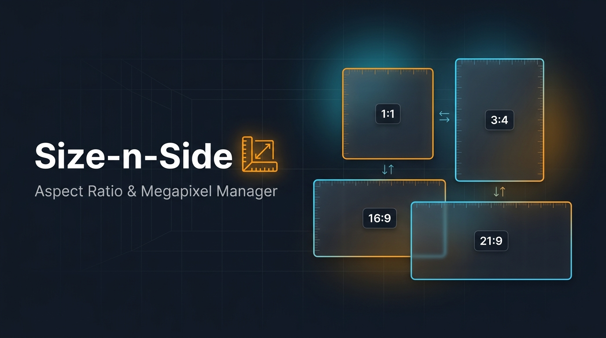

# 📐 Size-n-Side — Aspect Ratio & Resolution Manager

  <a href="#english">English</a> • <a href="#русский">Русский</a>

---

## English

**Size-n-Side** is a compact extension for Stable Diffusion WebUI / Forge Neo that eliminates manual slider tweaking and lets you set clean, accurate resolutions for any model in one click.

### Key Features

- **Ready-to-Use 1–5 MP Presets** — popular aspect ratios (`1:1`, `3:2`, `3:4`, `16:9`, `21:9`, `16:10`, `20:9`) organized into **1 MP – 5 MP** tabs, plus an **All (1–5 MP)** compact grid view for one-click access.
- **All Dimensions Divisible by 64** — every resolution is snapped to multiples of `64` for stable generation without distortions or VAE errors.
- **Smart Ratio Buttons with Active Highlight** — set your desired larger side (for example, `2560`) and click a ratio (such as `3:4`): the extension keeps the larger side locked and automatically calculates the smaller side (`1920×2560`). The active ratio button glows to show your current format at a glance.
- **Precise Megapixel Control (`Target MP`) Without Losing Aspect Ratio** — type any target megapixel count (e.g., `2.5` or `7`) or adjust with `−` / `+` buttons (`0.1 MP` step). Your current aspect ratio (`16:9`, `3:4`, or any custom ratio) is strictly preserved.
- **Hold-to-Repeat with Acceleration** — hold `+` or `−` for 1 second to smoothly scroll megapixels automatically; after 5 seconds the speed doubles. `↑` and `↓` arrow keys also work inside the input field.
- **Live Orientation & VRAM Load Indicator** — shows the current frame orientation (*Portrait*, *Landscape*, *Square*, etc.), visual preview boxes, exact dimensions, and color-coded megapixel load (cyan ≤ 2 MP, yellow 2–4 MP, orange 4–6 MP, red > 6 MP).
- **Quick Swap (`⇅ Swap ⇄`) & Undo (`↩`)** — flip width and height in one click, or step back through your previous resolutions (up to 10 steps in history).
- **10 Custom Preset Slots + Export / Import** — save up to 10 favorite resolutions (`P1–P10`) locally in your browser, and back them up or transfer them anytime via JSON file.
- **Full `txt2img` & `img2img` Support + Match Image Ratio** — both tabs work independently without interfering with each other. In `img2img`, the extension automatically switches to *Resize to*, and the **Match Image Ratio** button reads the loaded image's proportions and fits them to your current Target MP.

### Installation

1. Open the **Extensions → Install from URL** tab in Stable Diffusion WebUI / Forge Neo.
2. Paste the URL of this repository and click **Install**.
3. Go to the **Installed** tab and click **Apply and restart UI**.

---

## Русский

**Size-n-Side** — это компактное расширение для Stable Diffusion WebUI / Forge Neo, которое избавляет от ручного подбора ширины и высоты ползунками и помогает в один клик выставлять правильные разрешения для любых моделей.

### Главные преимущества

- **Готовые пресеты от 1 до 5 мегапикселей** — популярные форматы (`1:1`, `3:2`, `3:4`, `16:9`, `21:9`, `16:10`, `20:9`) разбиты по вкладкам **1 MP – 5 MP**, а для максимальной скорости есть общая компактная сетка **All (1–5 MP)**.
- **Все размеры строго кратны 64** — изображения генерируются стабильно, без искажений и ошибок VAE.
- **Умная кнопка формата (Ratio) с подсветкой** — выберите нужную длину большей стороны (например, `2560`) и нажмите на формат (например, `3:4`): расширение само зафиксирует большую сторону и аккуратно подгонит меньшую (`1920×2560`). Кнопка активного формата подсвечивается, чтобы вы сразу видели текущие пропорции.
- **Точная настройка мегапикселей (`Target MP`) без сброса пропорций** — введите нужное количество мегапикселей (хоть `2.5`, хоть `7`) или меняйте его кнопками `−` / `+` (шаг `0.1 MP`). Пропорции кадра (`16:9`, `3:4` и любые другие) при этом строго сохраняются.
- **Удобная прокрутка удержанием** — зажмите `+` или `−` на 1 секунду, чтобы мегапиксели начали плавно меняться сами; через 5 секунд скорость автоматически удвоится. Также работают клавиши `↑` и `↓` в поле ввода.
- **Наглядный индикатор ориентации и нагрузки** — в реальном времени показывает тип кадра (*Portrait*, *Landscape*, *Square* и т.д.), визуальную рамку, точное разрешение и мегапиксели с цветовой индикацией нагрузки на VRAM (голубой — до 2 MP, жёлтый — 2–4 MP, оранжевый — 4–6 MP, красный — выше 6 MP).
- **Быстрый переворот (`⇅ Swap ⇄`) и отмена (`↩ Undo`)** — меняйте ширину и высоту местами в одно нажатие или возвращайтесь к предыдущему разрешению через историю изменений (до 10 шагов назад).
- **10 слотов для своих пресетов + Экспорт / Импорт** — сохраняйте любимые разрешения (P1–P10) локально в браузере, а также выгружайте и загружайте их через JSON-файл для резервной копии или переноса.
- **Полноценная работа в `txt2img` и `img2img` + подбор по картинке** — вкладки работают независимо и не мешают друг другу. В `img2img` расширение само переключает режим на *Resize to*, а кнопка **Match Image Ratio** считывает пропорции загруженного изображения и подгоняет разрешение под ваши текущие мегапиксели.

### Установка

1. Откройте вкладку **Extensions → Install from URL** в Stable Diffusion WebUI / Forge Neo.
2. Вставьте ссылку на этот репозиторий и нажмите **Install**.
3. Перейдите в **Installed** и нажмите **Apply and restart UI**.

---
**Author:** Cj
